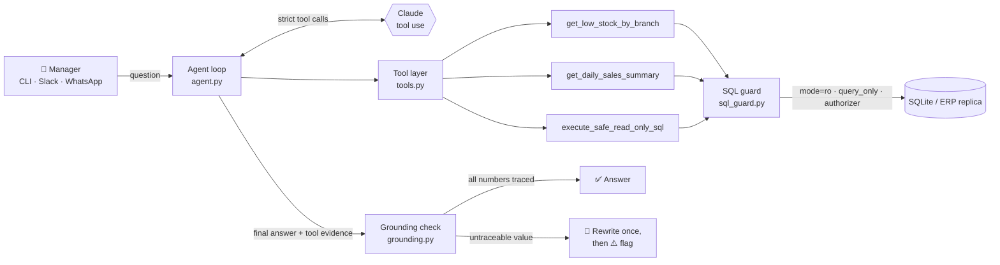
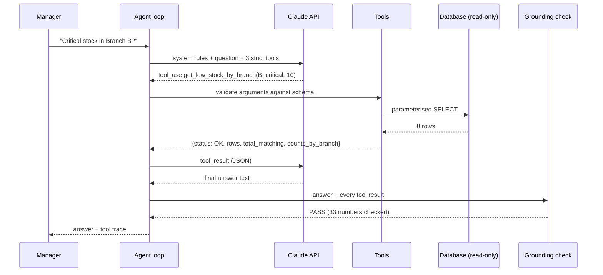
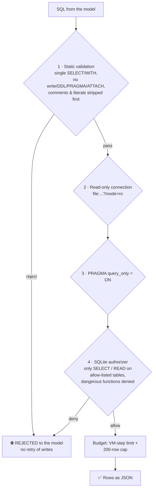
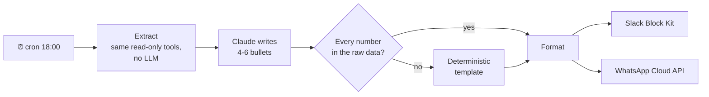
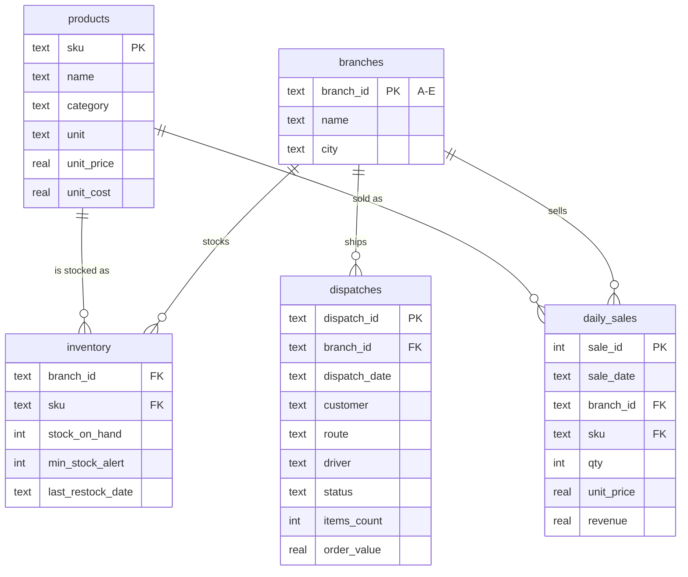

# Zero-Hallucination Inventory Agent

**An AI operations agent that answers inventory, sales and dispatch questions from your real database, and proves every number it gives you.**

Your branch managers ask the same questions every day: *What's about to run out? How did Branch D sell today? Which deliveries are late?* The answers live in your ERP or WMS, but getting them means a report request, a spreadsheet, or a call to someone in IT.

A generic chatbot is not the answer. Large language models are fluent, and a fluent model with no data will happily invent a stock level that looks right. In operations, a confident wrong number turns into a missed reorder, a stock-out, or a truck sent to the wrong place.

`zero-hallucination-inventory-agent` is the reference architecture I use to build AI agents that **cannot make data up**. Claude talks to your database only through a small set of strict, read-only tools, and every figure in its answer is checked against what those tools returned before anyone sees it. When the data is not there, the agent says so in plain words.


*Web console for a fictional distributor, Kestrel Supply Co. Every answer shows a verification badge and an audit trail of the database calls behind it.*


<details><summary>Plain-text version</summary>

```text
$ python agent.py --trace "Which SKUs are critically low in Branch B?"
  -> get_low_stock_by_branch({"branch_id": "B", "severity": "critical", "limit": 10}) => OK rows=8
  -> grounding: PASS (33 numbers checked)

8 SKUs are critically low (below 50% of reorder point) in Branch B.
- Branch B | SKU-1085 Ear Plugs Clear Std | stock 5 / min 100 (CRITICAL)
- Branch B | SKU-1003 PVC Pipe 1/2" Std | stock 4 / min 40 (CRITICAL)
...

$ python agent.py "What were sales on 2019-03-01?"
No records: there are no sales for all branches on 2019-03-01.
Sales data is available from 2026-10-14 to 2026-11-12.
```
</details>

---

## What makes it "zero-hallucination"

Most "chat with your data" demos rely on a polite system prompt and hope for the best. This project treats hallucination as an engineering problem and closes it with five independent controls:

| # | Control | What it prevents |
|---|---|---|
| 1 | **Tools are the only data source.** The model has no table access, no memory of your business, and a system prompt that forbids stating any fact a tool did not return. | Answers based on "typical" values or training data |
| 2 | **Strict tool schemas.** Every tool has a JSON schema with enums (`branch_id: A-E or ALL`, `severity: all/critical`), all fields required, `additionalProperties: false`, and `strict: true`. | Malformed or invented arguments, wrong branch codes |
| 3 | **Explicit empty results.** Every tool returns `status: OK`, `NO_RECORDS` or `REJECTED`. `NO_RECORDS` comes with an instruction not to estimate, plus context such as the available date range. | The model "filling in" an empty list |
| 4 | **Post-answer grounding check.** `grounding.py` extracts every number from the final answer (quantities, money, SKU codes, dates) and checks it against the tool results. One failed check sends the model back to rewrite; a second failure ships the answer with a visible warning. | A fabricated figure reaching a manager silently |
| 5 | **Read-only SQL in four layers.** See [Security](#security-read-only-by-construction). | Data changes, schema access, runaway queries |

> **About "temperature 0".** Current Claude models no longer accept sampling parameters such as `temperature`, so this project does not rely on them. Determinism comes from the architecture above: the model can only choose which tool to call and how to phrase verified values. On OpenAI models, the same tool definitions work with `temperature=0` if you want it as an extra layer.

---

## Architecture



### One question, end to end



### The tools

| Tool | Use | Notes |
|---|---|---|
| `get_low_stock_by_branch(branch_id, severity, limit)` | SKUs at or below their reorder point | `critical` = under 50 % of the reorder point. Returns totals per branch so "how many" questions never need guessing. |
| `get_daily_sales_summary(sale_date, branch_id)` | Revenue, units, transactions and top 3 SKUs for a day | Accepts `YYYY-MM-DD`, `today` or `latest`. Empty days return the available date range. |
| `execute_safe_read_only_sql(query)` | Anything else: dispatches, drivers, routes, categories, trends | One `SELECT` only, through the SQL guard, capped at 200 rows. The schema is documented in the tool description. |

The pre-built tools handle the questions people ask every day, with tested SQL. The SQL tool covers the long tail without giving up safety.

Tool definitions are **provider-neutral** (`ToolSpec` in `tools.py`) and render to both formats:

```python
from tools import anthropic_tools, openai_tools
anthropic_tools()[0]  # {"name", "description", "input_schema", "strict": True}
openai_tools()[0]     # {"type": "function", "function": {"name", "description", "parameters", "strict": True}}
```

---

## Security: read-only by construction

Letting an LLM write SQL against a production database is exactly where most teams get nervous, and rightly so. Here, a write has to get past **four independent layers at once**, and each layer is tested on its own:




* **Injection tricks are covered by tests**: `SELECT 1; DROP TABLE ...`, writes hidden behind `--` and `/* */` comments, `WITH ... DELETE`, `load_extension`, reading `sqlite_master`.
* **Defense in depth is verified**: the test suite turns off layer 1 and proves layers 2 to 4 still block `DELETE`, `UPDATE`, `INSERT`, `CREATE`, `DROP`, `ATTACH` and `PRAGMA writable_schema`.
* **Runaway queries are stopped**: a triple cross join is aborted by the execution budget instead of hanging the server.
* **Built-in tools use parameterised queries.** Only the explicit SQL tool accepts free-form SQL.
* In production, point the agent at a **read replica** with a **read-only database user** as well. The code-level layers then sit on top of database permissions instead of replacing them.

---

## Daily 6 PM digest for Slack / WhatsApp

`daily_digest.py` sends leadership a short end-of-day briefing without anyone opening a dashboard:


```text
Daily Ops Digest | 2026-11-12

• Revenue $93,875.64 across 5 branches (1,982 units, 150 transactions).
• Strongest: Branch A $27,506.82. Weakest: Branch D $13,666.70.
• Top seller: SKU-1162 Conduit 4x4 Eco ($9,962.68, 68 units).
• Critical stock: 33 SKUs (A: 5, B: 8, D: 13, E: 7); no alerts in C.
• Most urgent: SKU-1040 Absorbent Pads Citrus Pro at Branch D, stock 0 vs min 15.
• Dispatches: 2 delayed, 21 still pending or in transit.
```



The LLM only does the writing. The data is pulled deterministically, and if Claude's bullets contain a single number that is not in the raw data (a made-up percentage, a "rounded" total), the digest falls back to a template built from the same data. A 6 PM message to the CEO is never ungrounded, and it still goes out if the API is down.

```bash
python daily_digest.py                 # dry run: prints the digest, writes out/digest_<date>.json
python daily_digest.py --send slack    # posts to SLACK_WEBHOOK_URL
python daily_digest.py --send both     # Slack + WhatsApp Cloud API
```

```cron
# crontab -e
CRON_TZ=America/Mexico_City
0 18 * * * cd /opt/zero-hallucination-inventory-agent && /usr/bin/python3 daily_digest.py --send slack >> logs/digest.log 2>&1
```

---

## The web console

`app.py` is the screen a client's team would actually use: KPI cards straight from the tools, a chat with verification badges and an expandable "How I got this" trail, a filterable stock-alert table, and a preview of the 6 PM digest exactly as it lands in the team chat.


---

## Real-world use cases

* **Branch manager self-service**: "What do I need to reorder before Monday?" answered in seconds, from live stock.
* **Purchasing**: daily list of critical SKUs per branch, ready to turn into purchase orders or transfer requests between branches.
* **Logistics control tower**: "Which dispatches are delayed, on what route, with which driver?" with no dashboard to build.
* **Executive reporting**: the 6 PM digest replaces the manual end-of-day email.
* **Inventory balancing**: spot a SKU that is critical in Branch D while Branch C is overstocked, and move stock instead of buying more.
* **Safe AI pilot**: a read-only, auditable first AI project that IT and finance can approve, because it cannot change data.

The same pattern applies to any business with operational data: manufacturing (WIP, scrap, OEE), wholesale and distribution, retail chains, spare parts, pharma distribution and food service.

---

## Quick start (2 minutes, no API key needed)

```bash
git clone https://github.com/<you>/zero-hallucination-inventory-agent.git
cd zero-hallucination-inventory-agent
pip install -r requirements.txt

python seed_db.py                    # builds data/inventory.db (5 branches, 220 SKUs, 30 days)
python agent.py --trace "Which SKUs are critically low in Branch B?"
python agent.py "Any low stock in Branch C?"           # -> "No records ..."
python agent.py "sql: DELETE FROM inventory"           # -> rejected, nothing changed
python daily_digest.py
streamlit run app.py                 # web console (add ?demo=1 or ?demo=2 for a pre-filled conversation)
pytest -q                            # 50 tests
```

**Demo/Mock mode** turns on automatically when `ANTHROPIC_API_KEY` is empty. A deterministic offline planner stands in for Claude, while the tool dispatch, SQL guard and grounding check run exactly as they do in production. Questions in Spanish work too (`"ventas de la sucursal A hoy"`).

**Live mode:** copy `.env.example` to `.env` and set your key:

```bash
ANTHROPIC_API_KEY=sk-ant-...
ANTHROPIC_MODEL=claude-opus-5-5      # any current Claude model, e.g. claude-sonnet-5-5 for lower cost
ANTHROPIC_EFFORT=medium              # low | medium | high
```

The Claude backend uses the Messages API with strict client tools, prompt caching of the stable tools + system prompt prefix, and server-side refusal fallback. Adaptive thinking runs by default on current models.

---

## Database

`seed_db.py` builds a realistic, deterministic distributor dataset (fixed seed, so demos and tests are reproducible):



5 branches · 220 SKUs in 8 categories · 1,100 inventory rows · ~3,800 sales lines over 30 days · ~830 dispatches. Branch C is deliberately fully stocked, so you can watch the agent answer "no records" instead of inventing alerts.

Connecting your own data means swapping the SQLite file for a read replica (PostgreSQL, SQL Server, MySQL) and adjusting the SQL inside the three tools. The agent loop, guard-rails and grounding check stay the same.

---

## Project structure

```text
├── seed_db.py          # deterministic 5-branch distributor database
├── sql_guard.py        # 4-layer read-only SQL execution + resource limits
├── tools.py            # strict, provider-neutral tool definitions + implementations
├── grounding.py        # post-answer numeric verification
├── agent.py            # agent loop, Claude backend, offline mock planner, CLI
├── daily_digest.py     # 6 PM digest -> Slack / WhatsApp payloads + delivery
├── app.py              # Streamlit "Ops Copilot" console (chat, stock alerts, digest preview)
├── config.py           # env-driven settings
└── tests/              # 50 tests: guard layers, tools, grounding, agent loop, digest
```

The tests include a fake Claude client that replays scripted tool calls, so the loop is verified without network access: tool results go back in one message, a fabricated number triggers exactly one rewrite and then a visible warning, refusals are handled, and no sampling parameters are sent.

---

## Working with me

I build production AI agents for operations teams: inventory and ERP assistants, document-to-ERP automation, and reporting bots for Slack, Teams and WhatsApp. Every project ships with the same principles you see here: the AI only works with verified data, it is read-only unless writes are explicitly designed and approved, and there are tests that prove it.

**Typical engagement:** connect to your ERP/WMS read replica → map your top 10 operational questions to tools → deploy the agent and the daily digest to Slack or WhatsApp → hand over with tests and documentation.

If your team spends hours a week pulling the same numbers, or you want an AI pilot your IT department will actually approve, send me a message on Upwork with the questions your managers ask most.
